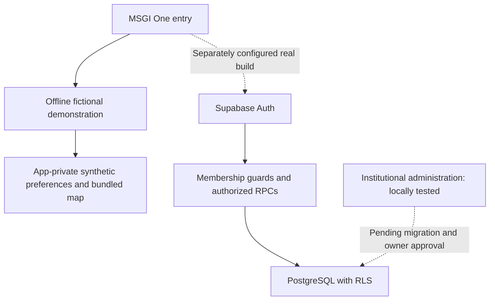

# College handover inventory

Prepared 2026-11-15. **Handover is not complete or institutionally accepted.**
MSEC names are reference context; demonstration people and affiliations are
fictional. The college must appoint actual authorized owners independently.

## Architecture and operating boundary

There is no demo-to-hosted-data path. Staff perspective is not administrator
authority. Client guards supplement server authorization; they do not replace it.

## Current inventory

| Area | What works / evidence | Ownership or remaining gate |
| --- | --- | --- |
| Competition APK | Frozen signed offline demo, Task 12A artifact/acceptance review. | Owner approves any sharing; never replace this file with a later build. |
| Student/Alumni/Staff experience | Local discovery, profiles, map, recommendations, careers and simulated connections; synthetic persistence. | Keep fictional labels; no institutional endorsement/adoption claims. |
| Current source | Flutter feature-first architecture, Riverpod, GoRouter; format/analyzer and regression tests. | Name maintainers, code review/release owner and access policy. |
| Professional onboarding/profile/discovery | Implemented and locally tested with backend contracts. | Hosted user acceptance and verified account provisioning are separate; frozen APK has no backend defines. |
| Hosted development backend | Last Task 11F read-only checkpoint: eleven migrations, 51 exact catalogs, zero administrators. Task 12A makes no hosted changes or new live verification. | Development-only, not public production. |
| Institutional administration | Twelfth migration and secure executor rehearsed locally. | Fresh backup, reviewed plan, private direct authentication and separate one-attempt owner authorization. |
| Verification and roles | Protected server records, live status/scope checks, owner-only bootstrap/lifecycle. | Authorize verification authority/evidence policy/reviewers; no self-provisioning. |
| Auth/email | Hosted signup/login/session/logout historically reported; local callbacks/recovery verified previously. | Approved domain/provider/sender/consented pilot; hosted recovery/email acceptance and activation remain gated. |
| Catalogs | MSEC institution/programmes and Science and Humanities kept distinct; approved skills catalog. | Identify catalog steward and approval/change process; no invented institutional records. |
| Backup/restore | Existing encrypted backup integrity and isolated recovery evidence; synthetic fresh procedure in Task 11F. | Current hosted predeployment backup still required. DPAPI portability/full-service recovery not established. |
| Signing | Dedicated certificate, local PKCS12 and DPAPI password files present; APK signature verified. | College-approved independent key/password backup, recovery test and restricted custody confirmation pending. No private material in this package. |
| Privacy/moderation | Narrow public fields, city-level consent design, protected review/audit workflows. | Approve notices, retention, appeals, audit access, incident response and support ownership. |
| Infrastructure | Android-first tooling, local Docker/Supabase test workflow and deployment reviews documented. | College account ownership, billing responsibility, access removal and monitoring. |

## Documents to retain

- Architecture: `architecture.md`, `decisions.md`, `database-schema.md`,
  `security-model.md`, `authentication-flow.md`.
- Setup and deployment: `supabase-setup.md`, `hosted-deployment-plan.md`,
  `real-user-launch-readiness.md`, Task 11B deployment/catalog reports.
- Administration: `institutional-admin-operations.md`, Task 11D/11E/11F reviews,
  `supabase/review/admin_executor_plan.json` and its exact approved hashes.
- Email: Task 11C.1 readiness and Task 11C.2A pilot preparation; templates are
  drafts, not proof of SMTP activation.
- Recovery: Task 11B.3 rehearsal, `admin-predeployment-backup-procedure.md` and
  Task 11F limitations. A logical dump is not a complete Supabase service backup.
- Android: `android-competition-release.md`, Task 12A audit and frozen artifact
  manifest. The historical build wrapper now refuses the existing frozen output.
- Presentation/submission: `competition-demo-script.md` and
  `competition-submission-checklist.md`.

Historical documents describe the state at their task date. Do not quote old
“not connected” or old test totals as current deployment status without context.

## Acceptance checklist for actual college owners

- [ ] Appoint verification-policy, technical, support/escalation and release owners.
- [ ] Approve identity evidence, reviewer appointment/removal and initial admin
      candidate/operation independently; Staff selection does not qualify a user.
- [ ] Approve moderation/appeals, privacy, retention, audit access and consent.
- [ ] Establish college-owned provider/domain/account custody and a consented
      email pilot; do not assume permission to use the official email domain.
- [ ] Review development/production separation, capacity and operating budget.
- [ ] Verify a current encrypted backup and independent recoverability, including
      signing credentials and the limits of Windows account-bound DPAPI.
- [ ] Approve pending schema deployment separately, then bootstrap separately.
- [ ] Perform controlled API-level authorization and real onboarding acceptance
      with approved consenting accounts; no fabricated institutional verification.
- [ ] Confirm dependency/IP/AI disclosure and source ownership requirements.
- [ ] Record signed institutional acceptance and an incident/support runbook.

Until accepted, public invitations, administrator grants, hosted Auth/SMTP changes,
unreviewed migrations and real-user rollout remain prohibited. Task 12A does not
authorize any of them.
